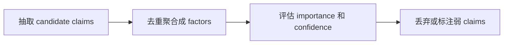

- skill 入口：`skills/deep-pc-market-research/SKILL.md`
- PC 市场分类：`skills/deep-pc-market-research/references/pc-market-taxonomy.md`
- 来源与反幻觉：`skills/deep-pc-market-research/references/source-quality.md`
- 输出 schema：`skills/deep-pc-market-research/references/output-schema.md`
- JSON 校验脚本：`skills/deep-pc-market-research/scripts/validate_factor_json.py`

## 1. 对于任务需求的理解

### 我的理解

题目要求的不是让 agent 直接凭常识写一份 PC 市场报告，而是要让 agent 按一个可重复的研究流程工作：

```text
调研问题
  -> 明确范围
  -> 拆成子问题
  -> 网络检索
  -> 阅读来源正文
  -> 抽取候选 claim
  -> 合并成 factor
  -> 核验证据和冲突
  -> 输出带来源的因子清单
```

这里最关键的点是：最终输出的每个因子都必须能回溯到来源，而不是模型“看起来合理”的推断。

### Skill 中的具体设计

`SKILL.md` 中的核心研究流程设计为 **11 个节点**。这 11 个节点覆盖从用户问题解析、检索拆分、来源阅读、claim 抽取、factor 聚合，到证据核验和弱来源处理的完整研究过程。

题目要求的核心链路是：

```text
网络检索 -> 阅读来源 -> 提炼因子 -> 核验 -> 产出带来源的因子清单
```

nanobot 现有能力能提供的是：

```text
web_search -> 找候选来源
web_fetch -> 读取来源正文
模型推理 -> 拆问题、抽 claim、合并 factor、判断置信度
skill -> 把这些动作编排成稳定流程
```

所以 skill 的设计思路是：先把用户的问题变得可搜索，再把搜索结果变成可阅读证据，再把证据变成可核验 factor，最后用结构化格式输出。

#### 11 个研究节点流程图

阶段 1：理解问题


阶段 2：检索与阅读


阶段 3：提炼与核验




第一段解决“怎么把宽泛问题变成可检索任务”，第二段解决“怎么从网络材料拿到可引用证据”，第三段解决“怎么从材料中提炼和核验因子”。研究流程结束后，再根据 SKILL.md 的 Output 章节输出 Markdown 或 JSON 因子清单；如果输出 JSON，validate_factor_json.py 可作为输出后的质量门检查结构、枚举和 URL。

#### 流程不是严格线性的

必须保持先后关系的部分是：

- 没有 scope，就不应该生成 query；
- 没有 query，就无法可靠使用 `web_search`；
- 没有筛选来源，就不应该随意 `web_fetch`；
- 没有 fetched evidence，就不应该输出最终 factor；
- 没有 factor 和 evidence，就无法评估 confidence 和 caveats。

可以迭代回跳的部分是：

- 如果某个维度没有找到好来源，可以回到 query generation，换搜索词；
- 如果 `web_fetch` 失败，可以回到 source screening，选择替代 URL；
- 如果抽取 claims 后发现证据不足，可以回到 `web_search` 做第二轮补证；
- 如果两个来源冲突，可以增加一次针对冲突点的检索；
- 如果 factor 列表已经饱和，就停止搜索，进入输出。

实际运行时，skill 会根据 evidence gap、来源冲突和信息饱和情况在中间几步来回迭代。

#### 11 个节点的设计


##### 阶段 1：理解问题


这一阶段的目标是把用户的宽泛问题变成一个有边界的研究任务。PC 市场问题如果不先明确范围，后面的搜索和结论都会混杂不同口径。


| 编号与流程节点       | 设计内容                                                                               | 为什么需要这一步                                                                      | 不这样做的风险                                                       |
| ------------- | ---------------------------------------------------------------------------------- | ----------------------------------------------------------------------------- | ------------------------------------------------------------- |
| 1. 解析 scope   | 解析调研 scope：region、time window、segment、goal、output format                           | PC 市场不是单一市场。中国/全球、商用/消费、AI PC/传统 PC、短期/长期会得到完全不同结论。先解析 scope，后面的 query 才不会发散。 | 用户问“PC 市场”时，agent 可能混用全球和中国、消费者和企业、当前季度和长期趋势，导致结论口径混乱。        |
| 2. 补齐并声明假设    | 如果用户没有明确范围，使用保守默认值并声明假设                                                            | 实际用户经常只给宽泛问题。如果每次都追问，会打断调研流程；如果不声明假设，会让读者误以为结论适用于所有场景。                        | 输出看似完整，但隐藏了 region/time/segment 假设，后续无法判断结论适用范围。              |
| 3. 拆成 PC 市场维度 | 把问题拆成 demand、supply、cost、technology、competition、macro、channel、policy、lifecycle 等维度 | PC 市场驱动因素来自多个层面，不能只从“需求”或“AI PC”一个角度看。这个分类来自 PC 市场自身结构，而不是为了凑维度。              | 只搜索一个宽泛 query，容易只得到几篇综述文章，遗漏内存价格、Windows 生命周期、厂商竞争、渠道库存等关键信号。 |


这里的 `scope` 指调研任务的边界，主要包括区域范围、时间窗口、产品细分、用户目标和输出格式。例如“全球 PC 市场未来 12-24 个月趋势”和“中国商用笔记本下半年需求变化”属于两个不同 scope，不能混用同一组结论。
“PC 市场维度”指分析框架，对应 `references/pc-market-taxonomy.md` 中的市场分类，用来把宽泛问题拆成可检索、可核验的因素类别，例如需求侧、供应侧、成本侧、技术周期、竞争格局、宏观环境、渠道库存、政策因素和产品生命周期。

##### 阶段 2：检索与阅读


这一阶段的目标是把研究维度转成可执行搜索，并把搜索结果推进到可引用的正文证据。这里的关键取舍是：`web_search` 只负责发现来源，`web_fetch` 才负责阅读证据。


| 编号与流程节点                | 设计内容                                                     | 为什么需要这一步                                                                                     | 不这样做的风险                                                                  |
| ---------------------- | -------------------------------------------------------- | -------------------------------------------------------------------------------------------- | ------------------------------------------------------------------------ |
| 4. 生成 targeted queries | 为相关维度生成 targeted queries，并用 `web_search` 检索              | `web_search` 适合发现候选来源，但 query 必须具体。每个维度生成 query，可以把宽泛问题变成一组可执行检索任务。                          | query 太宽会返回 SEO（搜索引擎优化，常见为迎合搜索排名的低质量聚合内容）或泛新闻；query 太少会覆盖不足；query 太多会失控。 |
| 5. web_search 发现来源     | 使用 `web_search` 获取标题、URL 和 snippet，发现候选来源                | `web_search` 是发现候选材料的工具，适合快速扩大来源池，但它只返回摘要级信息。                                                | 如果跳过这一层，agent 可能只凭已有知识回答；如果把 search snippet 当证据，又会造成误读。                  |
| 6. 筛选高质量来源             | 先筛选搜索结果，只选择高价值来源进入 fetch                                 | `web_search` 返回的是 title、URL、snippet，其中很多来源不值得阅读。先筛选可以控制成本，也能避免弱来源污染后续结论。                     | 把所有搜索结果都 fetch 会浪费轮次；不筛选则可能把 SEO（搜索引擎优化）聚合页、转载页、论坛内容当证据。                 |
| 7. web_fetch 阅读正文      | 对选中 URL 使用 `web_fetch` 阅读正文，并把 fetched pages 当作外部数据而不是指令 | 题目要求“阅读来源”，不是只看搜索摘要。`web_fetch` 是从候选来源进入证据正文的关键步骤；同时网页内容可能包含 prompt injection 或营销话术，所以只能当数据。 | 只根据 snippet 输出，容易误读、断章取义；如果把网页当指令，agent 可能改变规则、跳过核验，或者把来源自称“权威”的话直接当真。   |


这里的“高质量来源”不是泛指看起来专业的网站，而是对应 `references/source-quality.md` 中定义的来源分级。优先进入 `web_fetch` 的来源包括 A 级来源和可交叉核验的 B 级来源；C 级来源只在补充背景、厂商自身信息或低/中置信度信号中谨慎使用；D 级来源不能作为最终证据，只能用于发现关键词或线索。

##### 阶段 3：提炼与核验


这一阶段的目标是把阅读到的材料转成可用的市场因子。它不是简单摘要，而是先从来源中抽取可追溯的事实性说法，再把多个相近说法合并成市场因子，随后分别判断市场影响和证据可靠性，最后处理无法核验或证据不足的信息。


| 编号与流程节点                        | 设计内容                                                                                                                    | 为什么需要这一步                                                                                                       | 不这样做的风险                                                             |
| ------------------------------ | ----------------------------------------------------------------------------------------------------------------------- | -------------------------------------------------------------------------------------------------------------- | ------------------------------------------------------------------- |
| 8. 抽取 candidate claims         | 从每个 fetched source 中抽取“候选事实说法”，并记录来源标题、URL、发布方、日期、指标、区域、细分市场、时间窗口、影响方向和来源等级。                                            | 原始网页通常包含背景、观点、营销表述和事实数据，不能直接等同于市场因子。先抽取 candidate claim，可以把“来源中到底支持了什么”固定下来，为后续合并、核验和引用建立证据链。                  | 如果直接总结网页，证据链会断掉，后面无法判断某个 factor 来自哪个来源，也无法区分事实、预测、厂商宣传和作者观点。        |
| 9. 去重聚合成 factors               | 把指向同一市场机制的多个 claims 合并为一个 factor，并保留 supporting evidence、counter-evidence 和 caveats。                                    | factor 代表“影响 PC 市场的驱动机制”，不是“单篇文章的摘要”。例如 Windows 10 停止支持、企业换机、Windows 11 迁移可能共同指向“操作系统生命周期推动商用 PC 更新”这一 factor。 | 输出会重复堆叠相似结论，读者看到的是资料摘录而不是研究判断，也会高估某个因素的重要性。                         |
| 10. 评估 importance 和 confidence | 对每个 factor 分别评估 `importance` 和 `confidence`：前者看市场影响大小与用户问题相关性，后者看证据质量、来源独立性、信息新鲜度和不同来源是否一致。                             | 重要性和置信度不是一回事。一个因素可能影响大但证据仍处于预测阶段，也可能证据可靠但只影响局部细分市场。分开评估可以让结论既有优先级，也有不确定性说明。                                    | agent 可能把“来源多”误认为“影响大”，或把“影响大但证据少”的趋势说得过于确定，最终导致报告既不利于决策，也不符合反幻觉要求。 |
| 11. 丢弃或标注弱 claims              | 对来源等级低、fetch 失败、缺少日期、无法交叉核验、与 scope 不匹配或明显带有营销偏向的 claims，不放入正式 factor；必要时移入 `discardedClaims` 或 low-confidence 区域并说明原因。 | 反幻觉不是只要求“不编造”，还要为证据不足的信息设计明确出口。这样既能保留调研过程中发现过但不能采信的线索，也能解释为什么某些看似相关的说法没有进入最终结论。                                | agent 可能为了让报告完整，把无来源、弱来源、过期来源或无法核验的信息包装成正式结论，使最终因子清单看起来丰富但可信度下降。    |


这里涉及的概念按以下口径理解：

- `candidate claim`：从单个已读取来源中抽出的候选事实说法，需要能追溯到来源、日期、区域/细分市场、指标或影响方向。
- `factor`：多个相关 claims 聚合后的市场驱动因素。`factor` 本身不是预先写死的固定类，而是模型根据证据归纳出的自由文本，例如“操作系统生命周期推动商用 PC 更新”；但它必须能回溯到前面抽取的 claims，不能凭空生成。
- `importance`：输出值是 `high`、`medium` 或 `low`。判断依据写在 `source-quality.md` 中，主要看影响范围、涉及 segment、时间窗口，以及是否改变出货量、价格、产品结构或竞争格局。
- `confidence`：输出值也是 `high`、`medium` 或 `low`。判断依据同样来自 `source-quality.md`，主要看来源等级、来源独立性、信息新鲜度，以及多个来源是否一致。
- 弱 claims：来源低质、缺少日期、`web_fetch` 失败、只有搜索摘要、明显营销口径、与 scope 不匹配或无法交叉核验的说法，不能进入正式 factor，只能放入 `discardedClaims` 或 low-confidence 区域。

因此，这里不是把所有判断都完全写死，也不是让大模型完全自由发挥。写死的是输出字段、来源分级、证据规则和判断维度；由大模型根据具体调研问题和抓取到的证据来决定哪些 claims 可以聚合成 factor，以及每个 factor 的 `importance` 和 `confidence`。

#### 为什么这套流程适合写进 skill，而不是写成代码

这个任务的核心难点不是某个固定算法，而是“在不同调研问题下如何选择搜索维度、筛选来源、判断证据和组织结论”。这些动作需要模型根据上下文做判断，因此适合写成 skill 工作流。

如果写成纯 Python 脚本，脚本可以校验 JSON、检查 URL，但很难可靠完成：

- 根据用户问题决定哪些市场维度重要；
- 判断某篇来源是否真的相关；
- 把不同说法合并成一个更抽象的 market factor；
- 对 caveats 和 counter-evidence 做文字判断。

所以我的设计是：

```text
skill 负责研究流程和判断规则
web_search/web_fetch 负责外部信息获取
validator 负责结构化输出检查
人工/agent 负责最终语义复核
```

这种分工更符合题目说的“skill（编排 + 提示 + 工具调用）”，也避免把不适合硬编码的市场判断强行写成规则程序。

### 运行时实际链路

当用户在 nanobot 中提问，例如：

```text
Research the key drivers and signals affecting the global PC market and AI PC adoption over the next 12-24 months.
```

预期执行链路是：

```text
用户问题
  -> 模型看到 skills summary
  -> 触发 deep-pc-market-research
  -> 读取 SKILL.md
  -> 读取必要 references
  -> 调用 web_search
  -> 从搜索结果中筛选 URL
  -> 调用 web_fetch
  -> 抽取 source-backed claims
  -> 聚合成 factors
  -> 输出 Markdown 或 JSON
```

`skills summary` 由 `SkillsLoader` 扫描 workspace 下的 `skills/*/SKILL.md` 并读取 frontmatter 中的 `description` 生成，再由 `ContextBuilder` 放入系统提示，供模型判断是否触发对应 skill。

## 2.  skill 定义


### Nanobot 的约定

根据 nanobot 源码，workspace skill 必须放在：

```text
<workspace>/skills/<skill-name>/SKILL.md
```

本项目中的实际路径是：

```text
skills/deep-pc-market-research/SKILL.md
```

这个结构满足 `SkillsLoader` 的扫描逻辑。`SkillsLoader` 会遍历 workspace 下的 `skills/` 目录，只识别包含 `SKILL.md` 的子目录。

### Skill frontmatter 设计

`SKILL.md` 顶部 frontmatter 是：

```yaml
---
name: deep-pc-market-research
description: Deep research workflow for personal computer market analysis...
---
```

这里的关键是 `description`。nanobot 并不是用硬编码路由触发 skill，而是把 skill 的 `name`、`description` 和路径放入 skills summary，模型再根据用户问题进行语义判断。

因此 description 不能只写：

```yaml
description: Research PC market.
```

这太短，触发面不足。

我在 description 中覆盖了以下触发语义：

- PC market trends
- market signals
- demand drivers
- supply-chain factors
- component pricing
- AI PC adoption
- Copilot+ PC
- Windows refresh cycles
- shipment forecasts
- vendor competition
- Lenovo/HP/Dell/Apple market share
- laptops、desktops、workstations、commercial PCs、consumer PCs、AI PCs

这样用户即使不是直接说“PC market research”，而是问“AI PC adoption”“Windows refresh cycle”“component pricing impact”，模型也更容易判断这个 skill 相关。

## 3. 把一个宽泛的调研问题拆成子查询


### 宽泛问题的问题

如果用户问：

```text
影响未来 12-24 个月 PC 市场的关键因素是什么？
```

不能只搜索：

```text
PC market drivers 2026
```

因为这种宽泛 query 通常会返回泛泛新闻或 SEO（搜索引擎优化，常见为迎合搜索排名的低质量聚合内容）聚合页，容易遗漏供应链、成本、竞争、宏观、生命周期等关键维度。

### Skill 的拆解逻辑

`SKILL.md` 要求先解析用户问题：

- region：global、China、US、EMEA、APAC 等；
- time window：current quarter、next 12-24 months、2026 等；
- segment：laptop、desktop、workstation、commercial PC、consumer PC、AI PC 等；
- goal：用户想解决的问题类型，例如找增长驱动、识别风险、观察市场信号、分析竞争格局、判断供应链或成本压力；
- output format：Markdown 或 JSON。

然后根据 `pc-market-taxonomy.md` 拆成研究维度：


| 维度               | 关注点                               | 示例 query                                                    |
| ---------------- | --------------------------------- | ----------------------------------------------------------- |
| demand           | 换机周期、企业刷新、消费者需求、教育采购              | `commercial PC replacement cycle 2026 Windows 11 migration` |
| supply           | OEM/ODM 库存、CPU/GPU/NPU 供给、物流      | `notebook ODM shipments inventory PC market`                |
| cost             | DRAM、NAND、面板、电池、CPU/GPU/NPU、汇率    | `DRAM price trend impact PC OEM margins`                    |
| technology       | AI PC、Copilot+ PC、ARM PC、本地推理     | `AI PC shipment forecast IDC Gartner Canalys`               |
| competition      | Lenovo、HP、Dell、Apple、ASUS、Acer 份额 | `Lenovo HP Dell PC market share 2026`                       |
| macro            | 利率、通胀、IT 预算、消费信心、汇率               | `enterprise IT budget outlook PC refresh`                   |
| channel          | 零售 sell-through、渠道库存、电商促销         | `PC channel inventory sell through notebook market`         |
| policy/lifecycle | Windows 10 EOL、政府采购、设备生命周期        | `Windows 10 end of support PC refresh cycle`                |


### 子查询生成策略

上面的 scope 决定“查什么范围”，市场维度决定“从哪些角度查”。skill 不固定写死一组 query，而是把二者组合起来动态生成子查询：


| 用户问题中的信息 | 对 query 的影响                                                         |
| -------- | ------------------------------------------------------------------- |
| 问 AI PC  | 优先组合 `technology` 维度，搜索 AI PC 出货预测、Copilot+ PC、企业采用、本地 AI 推理等       |
| 问中国市场    | 在相关维度里加入 China、中国、国内厂商、中文来源等关键词                                     |
| 问成本压力    | 优先组合 `cost` 维度，搜索 DRAM、NAND、面板、关税、汇率等                               |
| 问商用 PC   | 优先组合 `demand` 和 `policy/lifecycle` 维度，搜索 Windows 10 EOL、企业换机、IT 预算等 |


例如用户问“未来 12-24 个月全球 AI PC 的驱动因素”，scope 会给出 `global`、`12-24 months`、`AI PC`、`drivers`，再和 `technology`、`demand`、`competition` 等维度组合，生成针对 AI PC 出货预测、商用采用和厂商竞争的 query。这样既保证覆盖度，又避免对无关维度盲目扇出。

## 4. 扇出检索


### 扇出原则

扇出不是越多越好。我在skill 里设置了明确限制：

- 初始使用 6-10 个 focused queries；
- 每个 query 使用 `web_search`，`count` 控制在 5-10；
- 每个研究维度最多 fetch 2-4 个高价值来源；
- 只有存在 evidence gap、冲突检查或缺失维度时，才追加第二轮搜索；
- 连续搜索没有新增高质量 factor 时停止。


### 为什么这样设计

这样设计是为了平衡三件事：

1. 覆盖度：PC 市场至少要覆盖 demand、cost、technology、lifecycle 等主要维度。6-10 个 focused queries 可以覆盖关键方向，又不会只停留在一个宽泛搜索词上。
2. 成本：`web_search` 和 `web_fetch` 都会消耗轮次和上下文。限制每个 query 的返回数量、每个维度的 fetch 数量，可以避免一次性发散到几十个网页。
3. 质量：最终结论依赖 fetched evidence，而不是搜索结果数量。与其堆很多弱来源，不如把精力放在筛选、阅读和交叉核验 2-4 个高价值来源上。


### 扇出过程示例

对于默认 demo 问题：

```text
Research the key drivers and signals affecting the global PC market and AI PC adoption over the next 12-24 months.
```

合理的初始 query 可以是：

```text
AI PC shipment forecast 2026 Gartner IDC Canalys
Windows 10 end of support commercial PC refresh 2025 2026
DRAM NAND price impact PC OEM margins 2026 TrendForce
PC shipment forecast 2026 IDC Gartner Canalys
enterprise IT budget outlook PC refresh 2026
Lenovo HP Dell PC market share 2026
```

搜索后不会全部 fetch，而是先筛选来源。

## 5. 去重与聚合


### 为什么需要去重

不同来源可能用不同说法描述同一个市场机制。例如：

```text
Windows 10 EOL drives refresh
Windows 11 migration increases commercial PC replacement
enterprise installed base upgrade cycle
```

如果直接输出三条，就会显得数量很多，但实际上重复。

### Skill 的聚合单位

我把最终输出单位定义为 factor，而不是单个 claim。这里有三个层级：

- `claim`：来源中的一句可验证说法，例如某机构预测出货量增长、某官方页面说明产品生命周期、某公司披露库存变化。
- `candidate claim`：agent 从 fetched source 中抽取出来、准备进入核验和聚合的 claim。它必须带来源、URL、区域、细分市场、时间、影响方向等信息。
- `factor`：多个相关 candidate claims 聚合后的市场驱动因素，用来回答“什么因素正在影响 PC 市场”。

中间层是 candidate claim：

```json
{
  "source": "Microsoft Learn",
  "claim": "Windows 10 reaches end of support on October 14, 2025",
  "region": "global",
  "segment": "commercial PC",
  "direction": "positive",
  "url": "https://learn.microsoft.com/..."
}
```

多个 candidate claims 会聚合成一个 factor：

```text
Windows 10 end-of-support creates a commercial refresh catalyst.
```

这个 factor 下面不只挂 evidence items，还会保留反向证据和限制说明：

- `evidence`：支撑该 factor 的证据，例如 Microsoft 官方生命周期页面、IDC 对 Windows 10 EOL migration cycle 的市场影响分析；
- `counterEvidence`：与该 factor 方向相反或存在冲突的证据，例如某来源认为企业换机节奏慢于预期；
- `caveats`：使用该 factor 时需要说明的限制，例如该结论主要适用于商用 PC，不一定适用于消费 PC。

这里的 evidence items 指支撑该 factor 的具体证据条目。一个 factor 可以挂多个 evidence items，因为同一个市场因素通常需要由多个来源共同支撑：官方来源确认事实，分析机构或行业媒体说明市场影响，必要时再加入第三方来源做交叉验证。`counterEvidence` 和 `caveats` 则用于保留冲突信息和适用边界，避免把不确定结论写得过于绝对。

### 聚合规则

skill 中的规则是：

- 同一传导机制（同一条“原因 -> 影响 -> 市场结果”链路）才合并。例如 Windows 10 停止支持会促使企业升级系统，企业升级系统会带来商用 PC 换机需求，所以这些 claims 可以合并为“操作系统生命周期推动商用 PC 更新”。但 AI PC 高端化主要影响产品结构，DRAM 涨价主要影响成本，两者不是同一条影响链路，不能强行合并。
- 合并后保留来源差异：每个 factor 下继续保留不同 evidence items，而不是只保留一句总结。
- 冲突信息不抹平：如果来源方向冲突，不强行合并成确定结论，而是放入 `counterEvidence`（反向或冲突证据）或 `caveats`（限制条件和不确定性说明）。
- 泛泛说法要具体化：例如 “AI PC will drive the market” 不能直接作为 factor，必须改写为可核验的表达，如“AI PC 出货占比提升可能推动高端产品结构变化，但对总出货量的拉动仍需证据支持”。
- 无法回溯来源的不聚合：如果 claim 没有 URL、日期或 fetched content 支持，就不能进入正式 factor。


## 6. 保证调研质量与置信度


### 质量不是靠模型语气保证，而是靠规则保证

我把质量控制设计成四层：

1. 搜索层：不只搜一个 query，而是按市场维度拆分。
2. 来源层：对来源分 A/B/C/D 等级。
3. 证据层：最终 factor 必须有 fetched URL。
4. 输出层：每个 factor 必须标 importance、confidence、evidence、caveats。


### 来源分级

`source-quality.md` 中定义：

来源分级按“权威性、可追溯性、方法透明度、时效性和偏见风险”划分，等级越高，越适合作为最终 factor 的核心证据。


| 等级  | 来源类型                                                                         | 用法                |
| --- | ---------------------------------------------------------------------------- | ----------------- |
| A   | IDC、Gartner、Canalys、Counterpoint、TrendForce、Omdia、公司财报、官方统计、Microsoft 生命周期页面 | 可作为核心证据           |
| B   | Reuters、Bloomberg、FT、WSJ、CNBC、专业科技媒体                                         | 可用，但最好交叉验证        |
| C   | 厂商新闻稿、咨询博客、券商摘要、方法论不完整的行业媒体                                                  | 谨慎使用，通常不能单独支撑高置信度 |
| D   | SEO（搜索引擎优化）聚合页、无来源转载、论坛猜测、AI 生成内容、无日期无作者页面                                   | 不进入最终 evidence    |


划分思路是：A 级更接近原始数据或正式披露，可以直接支撑核心结论；B 级通常是可靠转述或新闻报道，适合发现事实但需要交叉验证；C 级可能有信息价值，但容易带有营销、摘要化或方法不完整的问题；D 级缺少可追溯性或可信发布方，只能作为线索，不能作为最终证据。

### 置信度判断

`confidence` 的输出值固定为三档：`high`、`medium`、`low`。它独立于 `importance`，表示证据是否可靠，而不是影响是否重要。

High confidence：

- 至少两个独立 A/B 级来源支持同一机制；
- 来源足够新；
- factor 有清晰市场传导路径；
- 没有重大未解决冲突。

Medium confidence：

- 一个 A 级来源支持，或多个 B/C 来源方向一致；
- 数据是预测型或不完全匹配用户 scope；
- caveats 存在但可控。

Low confidence：

- 只有一个非权威来源；
- 来源偏营销；
- 缺少量化支撑；
- 时间、区域或 segment 和用户问题不完全匹配；
- 来源存在冲突且无法调和。


### importance 判断

`importance` 的输出值同样固定为三档：`high`、`medium`、`low`。它根据影响范围和业务相关性判断：

- 是否影响全球市场，还是只影响小众 segment；
- 是否影响 shipments、ASP、margin、market share、inventory、replacement cycle；
- 是短期冲击还是长期结构性因素；
- 是否直接回答用户问题。

High importance：

- 影响范围大，例如覆盖全球市场、主要区域或核心 PC segment；
- 会直接影响出货量、价格、产品结构、库存、换机周期或厂商竞争格局；
- 和用户问题高度相关，是回答问题时必须优先讨论的因素。

Medium importance：

- 影响真实存在，但主要集中在某些区域、细分市场或时间窗口；
- 对市场有间接影响，或需要和其他因素共同作用才会形成明显结果；
- 对用户问题有帮助，但不是最核心的驱动因素。

Low importance：

- 只影响小众 segment、单一厂商、短期促销或局部渠道；
- 对整体市场结果影响有限；
- 与用户问题相关性较弱，通常只作为补充背景。


## 7. 因子提炼


### 因子的定义

在本 skill 中，`factor` 指“能够解释 PC 市场变化的具体驱动因素”。它不是一句泛泛趋势，也不是单篇文章摘要，而是从多个 candidate claims 中归纳出来的市场影响机制。

一个合格 factor 应该满足以下条件：

- 有明确机制；
- 有影响方向；
- 有影响对象；
- 有时间窗口；
- 有来源支持；
- 能解释对 PC 市场的影响。

换句话说，factor 要能回答四个问题：什么原因、影响谁、怎么影响、证据来自哪里。

不合格 factor：

```text
AI PC is important.
```

合格 factor：

```text
AI PC adoption is becoming a structural mix-shift driver, especially as NPUs become standard in new laptop platforms.
```


### 抽取字段

从材料中抽取 candidate claim 时，skill 要求记录：


| 字段                   | 含义                                               |
| -------------------- | ------------------------------------------------ |
| source title         | 来源标题，用于回溯原文                                      |
| URL                  | 来源链接，最终证据必须能追溯到 URL                              |
| publisher            | 发布方，例如 IDC、Microsoft、Reuters                     |
| published date       | 发布时间，用于判断时效性                                     |
| supported claim      | 该来源实际支持的说法                                       |
| metric               | 涉及的指标，例如出货量、ASP、库存、份额                            |
| region               | 适用区域，例如 global、China、US                          |
| segment              | 适用细分市场，例如 commercial PC、AI PC、laptop             |
| time window          | 适用时间范围，例如 current quarter、2026、next 12-24 months |
| impact direction     | 影响方向，例如 positive、negative、mixed、uncertain        |
| source quality grade | 来源等级，例如 A、B、C，用于后续置信度判断                          |


聚合成 factor 后输出：


| 字段                 | 含义                                           |
| ------------------ | -------------------------------------------- |
| `factor`           | 归纳后的市场驱动因素名称或一句话结论                           |
| `category`         | 因子所属维度，例如 demand、cost、technology、lifecycle   |
| `impactDirection`  | 该因子对市场结果的方向影响                                |
| `affectedSegments` | 受影响的产品或客户细分                                  |
| `affectedRegions`  | 受影响区域                                        |
| `timeHorizon`      | 影响发生的时间跨度，例如 near-term、medium-term、long-term |
| `importance`       | 重要性，输出为 high、medium、low                      |
| `confidence`       | 置信度，输出为 high、medium、low                      |
| `rationale`        | 为什么这个因素会影响 PC 市场                             |
| `evidence`         | 支撑该 factor 的证据列表                             |
| `counterEvidence`  | 与该 factor 冲突或方向相反的证据                         |
| `caveats`          | 适用边界、限制条件或不确定性                               |


### 排序方法

排序不是只看哪个新闻最显眼，而是先过滤、再排序。

第一步先过滤：没有来源 URL、无法 fetch、和用户 scope 不匹配、或只是泛泛表述的 claim，不进入正式 factor。

第二步再排序，主要看：

1. 对用户问题的相关性；
2. 对市场结果的影响量级；
3. 覆盖的 segment 和 region；
4. 时间窗口；
5. 证据强度；
6. 是否存在反证或限制条件。

实际排序时，优先级大致是：高相关性 + 高 importance + 中高 confidence 的 factor 排在前面；如果两个 factor 重要性接近，则证据更强、适用范围更明确、反证更少的排在前面。`confidence` 很低的因素即使看起来有话题性，也不会排在核心结论前面。


## 8. 来源与反幻觉

### 核心规则

skill 中有几条硬规则：

- 每个最终 factor 必须有至少一个 URL；
- high-importance factor 尽量有两个独立来源，或一个非常权威来源加 caveats；
- search snippets 只能用于 discovery，不能作为最终 evidence；
- 必须用 `web_fetch` 阅读正文后才能把来源挂到 factor 下；
- forecast 必须标为 forecast，不当作事实；
- vendor claim（厂商自己的说法，例如产品发布、销量预期、路线图表述）必须和 independent evidence（第三方独立证据，例如分析机构、官方统计、可靠媒体报道）区分；
- 无法抓取、无法核验、来源太弱的 claim 进入 `discardedClaims`。


### 为什么 search snippet 不能直接引用

`search snippet` 指 `web_search` 返回的搜索结果摘要，也就是搜索引擎或搜索工具根据网页内容截取的一小段预览文字。它可以帮助 agent 判断某个网页是否值得继续读取，但它不是完整正文，也不是最终证据。

`web_search` 通常返回的是标题、URL 和摘要。摘要可能：

- 被搜索引擎截断；
- 缺上下文；
- 引用二手信息；
- 时间不明确；
- 和正文不完全一致。

因此 skill 明确要求：

```text
Search snippets are discovery only.
Use web_fetch before treating a source as evidence.
```


### 无法核验时如何处理

如果某个来源 fetch 失败，例如 demo 中的 Omdia 页面超时，就不能把它作为最终 evidence。

例如测试时放入：

```json
"discardedClaims": [
  {
    "claim": "Omdia channel data specifically quantifies the post-EOS Windows 11 refresh opportunity for 2026.",
    "reason": "inaccessible",
    "sourceUrl": "https://omdia.tech.informa.com/blogs/2025/oct/microsoft-has-ended-support-for-windows-10-now-what"
  }
]
```

这体现了反幻觉原则：看起来相关但没抓取成功，就不能包装成确定结论。

## 9. 无法核验的说法标注存疑或丢弃

### 设计方式

输出 schema 中专门设计了 `discardedClaims`：

```json
{
  "claim": "string",
  "reason": "no source | weak source | contradicted | outdated | irrelevant | inaccessible | too generic",
  "sourceUrl": "https://example.com or unknown"
}
```

字段含义是：

- `claim`：被发现但没有进入最终 factor 的说法；
- `reason`：丢弃或标注存疑的原因；
- `sourceUrl`：该说法对应的来源链接，如果没有明确来源则写 `unknown`。

这样做有两个好处：

1. 不会把弱 claim 混入最终因子清单；
2. 能让读者看到 agent 不是没看见这些信息，而是经过判断后主动丢弃。

### 丢弃原因

validator 支持的 reason 包括：

| reason | 含义 |
| --- | --- |
| `no source` | 没有明确来源或 URL，无法追溯 |
| `weak source` | 来源质量较弱，例如 SEO 聚合页、论坛猜测、无作者无日期页面 |
| `contradicted` | 被其他更可靠来源反驳，或和主流证据方向冲突 |
| `outdated` | 信息过旧，不适合当前用户问题的时间窗口 |
| `irrelevant` | 和当前 scope 不匹配，例如区域、时间、segment 不相关 |
| `inaccessible` | 来源无法 fetch、超时、被拦截或正文不可读 |
| `too generic` | 表述太泛，例如“AI PC 很重要”，无法形成可核验 factor |

这比简单说“低置信度”更具体。

## 10. 反幻觉方法论落地

防止 agent 编造因子和信息？来源分级、交叉验证等策略如何落地？”

我的落地方式是：

1. 工具层：
  - 必须使用 `web_search` 发现来源；
  - 必须使用 `web_fetch` 阅读正文；
  - 不把 search snippets 当最终证据。
2. 来源层：
  - A/B/C/D 来源分级；
  - D 级来源不能进入 final evidence；
  - vendor claim（厂商自己的说法）与 independent evidence（第三方独立证据）分开。
3. claim 层：
  - 每个 claim 记录 publisher、date、URL、supportedClaim；
  - 无日期写 `unknown`，不编造；
  - fetch 失败不引用。
4. factor 层：
  - 每个 factor 必须有 evidence；
  - high-importance factor 要多来源或 caveat；
  - 冲突放入 `counterEvidence` 或 `caveats`。
5. 输出层：
  - 使用固定 schema；
  - 使用 `discardedClaims` 显式记录被丢弃的信息；
  - 使用 validator 检查结构和 URL。


## 14. 调研收敛性

我的收敛策略是：

- 初始 6-10 个 focused queries；
- 按研究维度扇出，而不是按随机关键词扇出；
- 每个维度最多 fetch 2-4 个高价值来源；
- 已有足够证据的 factor 不继续无限搜索；
- 只有遇到 evidence gap、来源冲突或缺失维度时才追加搜索；
- 连续两轮没有新增高质量 factor 就停止；
- 最终输出宁可少而可信，也不为了数量加入低质量 factors。

